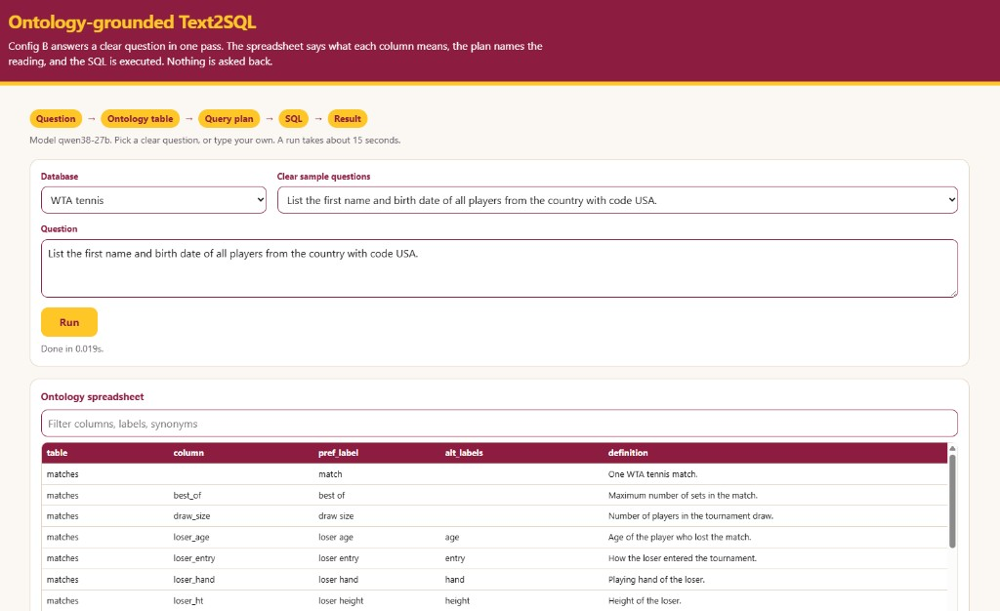

# Ontology-Grounded, Uncertainty-Aware Text2SQL

CSE 573 Semantic Web Mining, Fall 2026, Arizona State University
Group 26, Project 13: Saniya Mulla, Vian Yeh, Manas Khare, Vatsal Patel, Manav

Text-to-SQL lets someone ask a relational database a question in ordinary language and get an SQL query back. Large language models write that SQL well when the question is precise and the column names already say what they mean. Real questions often fail one of those conditions. A name like `amt_2` or `dt_close` does not say what is stored there, and a phrase like "from March 2018" can point at more than one date column. The query that comes back can run and still answer a different question from the one the person asked.

This project treats that as a decision under uncertainty. Each database gets a small Semantic Web ontology, written in RDFS and SKOS, that gives every table and column a label, synonyms, and a definition. The ontology is used twice. It is extra context when the model writes SQL, and it is an explicit test for ambiguity: if a phrase in the question matches more than one schema element, and nothing else in the question settles which one, the system should ask one clarification question before it writes SQL. A later check then tests the query for syntax, schema, and execution errors and repairs it at most twice.

The decision rule is

```
U(q, S, O) = number of phrases in q that the ontology maps to more than one schema element

if U = 0:  write SQL
if U > 0:  ask one clarification, append the answer, then write SQL
```

`U` is a count, not a learned confidence score. The reason a question was flagged can be read off the ontology.

## Where earlier methods stop

Most Text-to-SQL work assumes one intended query can be read off the question, and it leaves the meaning of the schema inside the column names.

| Line of work | What it does well | What it leaves open |
|---|---|---|
| Schema-aware parsers (Seq2SQL, SQLNet, RAT-SQL) | Encode tables, columns, and the links between question tokens and the schema | The names themselves stay unexplained. `date_adopted` and `date_departed` are just two different strings. |
| Intermediate forms and constrained decoding (IRNet / SemQL, PICARD) | Plan first, then reject SQL that would be invalid | A query can be valid and still be the wrong reading of the question. |
| Staged LLM pipelines (DIN-SQL) | Split linking, decomposition, generation, and self-correction into prompts | Self-correction repairs a broken query. It does not decide that the question was too vague to answer. |
| Conversational benchmarks (SParC, CoSQL) | Study follow-up questions across turns | They do not decide, for a single question, whether the system should ask before it answers. |

The shared gap is that no method pairs an explicit schema ontology with a rule for when to ask. Without the ontology, the model has to guess what a column means. Without the rule, it has to guess even when two columns are equally plausible, and the guess comes back as SQL that executes.

## How this method uses the ontology

The ontology is a spreadsheet the team fills in, one row per column: a preferred label, synonyms separated by `|`, and a one-line definition. A short script turns that sheet into Turtle. Tables become classes, columns become properties, and foreign keys become relationships between classes. Shared synonyms are written only where a person could honestly mean either column. On `dog_kennels`, both `date_adopted` and `date_departed` carry the synonym `date`, and each keeps its own definition.

That one fact does two jobs.

- **Context.** Config B pastes the labels, synonyms, and definitions into the SQL prompt, next to the usual `CREATE TABLE` text. The model sees "adoption date" and "Date the dog was adopted by an owner" instead of only `date_adopted`.
- **Ambiguity test.** `lookup("date")` returns every column that lists `date`. Two or more hits means the phrase is ambiguous. `lookup("adoption date")` returns one column, so that phrase is settled. The clarification question, when it is asked, is built from those definitions: "By 'from March 2018', do you mean the date the dog was adopted, or the date it left the kennel?"

A clear question never takes that branch. The ontology still supplies the meanings, a query plan records the tables, filters, and phrases, and SQL is written in one pass. That is the path the demo below runs.

## Architecture

The full pipeline from the project proposal. A clear question goes straight from the plan to SQL. An ambiguous question takes one clarification, answered in the experiments by a simulated user who never sees the gold SQL. Every generated query is checked, and a failing query is repaired at most twice.


Each stage can be switched off, so a gain can be tied to the stage that produced it. Every configuration uses the same model, temperature 0, the same questions, and the same SQL prompt. Stages add context. They do not rewrite the prompt.

| Config | Ontology context | Clarification | Verification | What it answers |
|---|---|---|---|---|
| A. Direct baseline | | | | Schema DDL and the question only |
| B. + Ontology | yes | | | Do labels, definitions, and a plan raise accuracy on their own? |
| C. + Clarification | yes | yes | | Can ontology matching find ambiguous questions, and does one question fix them without interrupting clear ones? |
| D. Full system | yes | yes | yes | Do syntax, schema, and execution checks add anything through self-repair? |

## Demo

`ontosql demo` opens a local page that runs the full system (config D) with a real person in place of the simulated user. Pick a database and its ontology spreadsheet loads. The sample questions are the clear and ambiguous items from the stress set, or type your own.

* A clear question goes straight through: plan, SQL, checks, and the result table, with the spreadsheet rows the plan used highlighted.
* An ambiguous question stops first. The page says which phrase is ambiguous and why, shows the clarification question built from the ontology definitions, and offers one button per reading plus a free-text box. Your answer is appended to the question exactly as the simulated user's answer is in the experiments, then the SQL is written, checked, and repaired if needed.
* When the question is one of the stress-set items, the page also says whether the result matches the gold SQL.

The screenshots below show the clear-question path.




```bash
ontosql demo
```

Then open http://127.0.0.1:7860. A question that has not been run before takes several seconds. A repeated question returns immediately, because model replies are cached.

## What is in place

| Piece | Status |
|---|---|
| Config A, execution match, metrics, result tables | Done. Gold SQL scores 222/222 on the Spider dev questions for the three databases, so the evaluator itself is sound. |
| Databases, ontology spreadsheets, Turtle | Done for `dog_kennels`, `student_transcripts_tracking`, and `wta_1`. |
| Query planning and config B | Done. Bad plan JSON is retried once, then generation continues without a plan. |
| Ambiguity stress set | Done. 20 clear Spider questions and 20 ambiguous rewrites (5 each of column, temporal, aggregation, and reference). Every interpretation executes, and the readings of an ambiguous item return different rows. |
| Ambiguity detection (config C) | Done. Deterministic rule over the SKOS labels plus a small aggregate vocabulary; every flag names the phrase and the competing columns. |
| Clarification and simulated user (config C) | Done, with the safeguards described below and wrong / oracle / vague controls. |
| Verification and repair (config D) | Done. Syntax (sqlglot), schema (every table and column, with "did you mean" hints) and read-only execution; at most two repairs. |
| Classical baselines | Done. TF-IDF and BM25 schema linking and a BM25 score-margin ambiguity detector, compared against the ontology (`ontosql linking`, no LLM calls). |
| Demo | Done for the full system: an ambiguous question is answered by the person at the keyboard. |
| Error analysis | Done. Every wrong answer is labelled in `evaluations/error_analysis/errors_labelled.csv`. |

## Setup

```bash
python -m venv .venv
.venv\Scripts\activate                 # macOS/Linux: source .venv/bin/activate
pip install -e ".[dev]"
ontosql get-spider                      # downloads Spider, keeps the dev split (~130 MB)
copy .env.example .env                  # macOS/Linux: cp; then paste your Voyager key
ontosql models                          # check which models your key can use
pytest                                  # should be all green
```

`.env` needs `LLM_API_KEY` and `LLM_MODEL`. The runs so far use `qwen38-27b` on ASU Voyager, temperature 0.

## Running experiments

```bash
ontosql run --config A                       # predictions -> evaluations/runs/A/predictions.jsonl
ontosql evaluate --config A                  # execute + score -> scored.jsonl, summary.json
ontosql report                               # tables -> evaluations/tables/
ontosql errors                               # wrong answers -> evaluations/error_analysis/errors.csv
```

Run A, B, C and D the same way. Simulated-user controls and the classical baselines:

```bash
ontosql run --config C --user wrong --tag wrong        # then: ontosql evaluate --config C --tag wrong
ontosql run --config C --user oracle --tag oracle
ontosql run --config C --vague-rate 0.2 --tag vague20
ontosql linking                                        # TF-IDF / BM25 vs ontology, no LLM calls
```

Useful flags: `--dataset stress|spider|all` (default `stress`), `--limit 5` for a
quick smoke test, `--workers 4` for parallel model requests, `--dbs dog_kennels,wta_1`
to override `data/selected_dbs.txt`. Model replies are cached in `.cache/llm/`, so
re-running a configuration costs nothing. The full protocol is in `docs/EXPERIMENTS.md`.

Other commands: `ontosql check-stress --execute` validates the stress set and
runs every gold and interpretation query; `ontosql schema --db dog_kennels`
prints a schema; `ontosql build-ontology --db dog_kennels` regenerates Turtle
from the spreadsheet.

## Metrics

| Metric | Definition |
|---|---|
| Execution Accuracy (EX) | Share of questions whose SQL returns the gold result; reported for clear and ambiguous questions separately |
| SQL Validity Rate | Share of generated queries that parse and execute |
| Ambiguity detection | Precision, recall and F1 of the clarification flag on the stress set |
| Unnecessary Clarification Rate (UCR) | Share of the clear stress-set questions where the system still asks |
| Clarification Gain (CG) | EX(C) minus EX(B) on ambiguous questions |

Result comparisons are reported with 95% paired-bootstrap confidence intervals, since the stress set is about 40 questions. Exact string match on the SQL is not used. Equivalent queries can be written many ways, and execution accuracy already checks the answer.

## Results

All runs use `qwen38-27b` on ASU Voyager at temperature 0. Tables are regenerated by `ontosql report` and `ontosql linking` into `evaluations/tables/`.

**Main ablation, Ambiguity Stress Set (40 questions: 20 clear, 20 ambiguous), %**

| System | EX | EX clear | EX ambiguous | Validity | Ambiguity P / R | Unnecessary clarification | Clarification gain |
|---|---|---|---|---|---|---|---|
| A. Direct baseline | 67.5 | 80.0 | 55.0 | 100 | - / 0 | 0 | - |
| B. + Ontology context | 70.0 | 90.0 | 50.0 | 100 | - / 0 | 0 | - |
| C. + Clarification | 80.0 | 90.0 | 70.0 | 100 | 100 / 100 | 0 | +20.0 |
| D. Full system | 80.0 | 90.0 | 70.0 | 100 | 100 / 100 | 0 | +20.0 |

* The ontology context helps clear questions (80 to 90%) but not ambiguous ones (55 to 50%): more meaning does not resolve a question that has two meanings.
* Asking one question raises accuracy on ambiguous questions from 50 to 70%, without asking about any clear one.
* Verification adds nothing here: every generated query was already valid, so no repair was triggered.
* With 40 questions the 95% intervals are wide (D vs A: +12.5 points, CI -2.5 to +27.5), so these are directional results.

**Is the gain from the simulated user? (config C, %)**

| Simulated user | EX | EX ambiguous |
|---|---|---|
| Wrong reading (control) | 45.0 | 0.0 |
| Realistic, 20% vague replies | 82.5 | 75.0 |
| Realistic (main result) | 80.0 | 70.0 |
| Oracle reading (upper bound) | 82.5 | 75.0 |

A wrong answer drives ambiguous accuracy to 0%, so the gain comes from the information in the answer, not from the act of asking. The realistic user is within one question of the oracle. One ambiguous question is worth 5 points, so the vague run being level with the oracle is within noise.

**Classical baselines (no LLM)**

Schema linking against the columns each gold query reads (join keys excluded), 214 Spider dev + 39 stress questions (questions whose gold query reads no column, such as `count(*)`, are skipped):

| Method | Recall@3 | P | R | F1 |
|---|---|---|---|---|
| TF-IDF, column names | 67.0 | 44.3 | 67.0 | 53.4 |
| BM25, column names | 66.3 | 44.5 | 66.3 | 53.2 |
| BM25, names + ontology labels | 68.4 | 44.5 | 68.4 | 53.9 |
| Ontology matching (SKOS labels + context rules) | 66.3 | 66.7 | 69.9 | 68.2 |

Ranked retrieval finds the right columns about as often, but it has no notion of "enough": it always returns its top three. The ontology links only the columns the question names, so precision is 22 points higher (F1 68.2 vs 53.9).

Ambiguity detection:

| Detector | P | R | F1 | Flags on 222 clear Spider questions |
|---|---|---|---|---|
| Ontology rule | 100 | 100 | 100 | 4.5% |
| BM25 score margin, best tau (0.05) | 66.7 | 50.0 | 57.1 | 23.4% |

The ontology rule was developed while the stress set was being built, so its stress-set score is optimistic. The Spider column is the out-of-sample check: it asks about 4.5% of questions nobody tuned it for, against 23% for the best classical detector.

**Larger check: 222 clear Spider dev questions, %**

| System | EX | Validity | Asked a clarification |
|---|---|---|---|
| A. Direct baseline | 75.2 | 99.5 | - |
| B. + Ontology context | 77.5 | 100 | - |
| D. Full system | 77.5 | 100 | 4.5 (10 of 222) |

* The ontology context adds 2.3 points on clear questions (95% CI -1.4 to +5.9), the same direction as on the stress set.
* The full system asks unnecessarily on 10 of 222 questions and loses no accuracy from it; no repair was triggered.

Tables: `evaluations/tables_spider/`.

**Why the full system still fails (labelled errors, config D, 8 wrong answers)**

| Category | Count |
|---|---|
| Projection (right columns and filters, wrong output shape) | 4 |
| Join / set logic | 2 |
| Unresolved ambiguity (asked about the wrong phrase) | 2 |

In A and B, 8 to 9 of the wrong answers were unresolved ambiguity. After clarification, the remaining errors are mostly about output shape, which the stress set's gold queries specify strictly.

## Repository layout

| Path | What's there |
|---|---|
| `code/ontosql/` | The pipeline package (baseline, ontology, planning, evaluation, demo, CLI) |
| `demo/` | The config B demo page |
| `code/tests/` | Unit tests on a small fixture database |
| `data/ontology/` | Spreadsheets and generated Turtle for the three databases |
| `data/stress_set/` | The 40-question Ambiguity Stress Set |
| `evaluations/` | Run outputs, scored predictions, result tables |
| `docs/` | Architecture, experiment protocol, per-member work packages, figures for this page |

Each member's work package, with interfaces and acceptance checks, is in `docs/team/`.

## Data

The experiments use three Spider dev databases chosen because their columns are easy to mix up: `dog_kennels` (five date columns), `student_transcripts_tracking` (several dates and repeated detail columns), and `wta_1` (winner/loser pairs and several dates).

Spider 1.0 (Yu et al., EMNLP 2018) is distributed under CC BY-SA 4.0 and is not committed here. `ontosql get-spider` downloads it.
